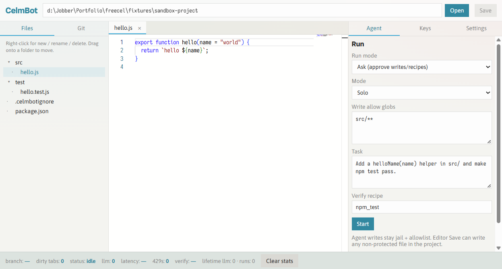
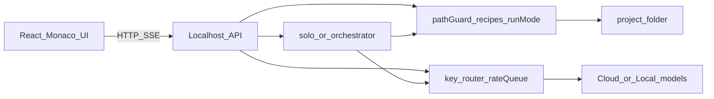
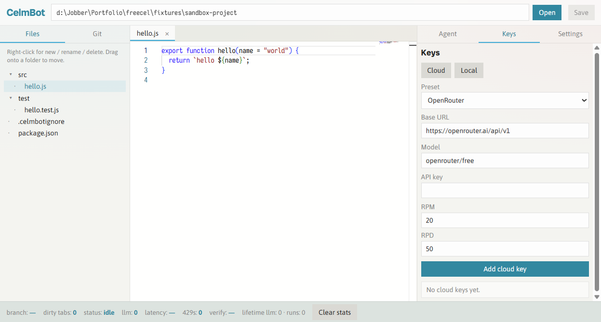

# CelmBot

[](https://github.com/cdsw/celmbot/actions/workflows/ci.yml)
[](LICENSE)
[](package.json)

A small local web app for practicing verification-first agent workflows on free (or local) models. No Cursor. No account. Not meant for serious unattended coding.

Inspired by [Lauren Tan](https://github.com/poteto)’s [pstack](https://github.com/cursor/plugins/tree/main/pstack) (MIT) — the prove-it-works mindset, skills/playbooks, and multi-agent ideas — but as a free-tier playground you can run yourself.



```bash
npm install
npm run build
npx tsx src/cli.ts
# → http://127.0.0.1:7429
```

For local UI/API development with hot reload:

```bash
npm run dev
# API:  http://127.0.0.1:7429  (tsx watch — restarts on src/ changes)
# UI:   http://127.0.0.1:5179  (Vite HMR — use this URL)
```

## Architecture



## Features

- Opens on localhost only (`127.0.0.1:7429`)
- **Editor shell**: Monaco (VS Code’s editor engine), file tree, tabs, Save / Ctrl+S
- **Local git**: status, stage, discard, commit, diff, log (`git` on your PATH)
- Separate **Cloud** and **Local** key lists; per-key rate limits; skips keys that just hit 429
- Agents stay inside a project folder + write allowlist; verify via allowlisted recipes (not a raw shell)
- Operator **chat host** (session transcript + Send; follow-ups queue while a run is active)
- Solo or **orchestrated swarm** (scoped workers, aggregate report, shared verify), approval cards, roster, queue banner, timeline, usage/latency stats
- Drop in markdown skills (pstack-style `SKILL.md` works)



## Honest limits

Free models are slow and capped. That’s the point — you feel the queues. This is not OpenHands or Cursor, and it won’t babysit a repo overnight in the cloud.

## Docs

- [ARCHITECTURE.md](docs/ARCHITECTURE.md) — modules and data flow
- [TRUST.md](docs/TRUST.md) — what the jail actually guarantees
- [adr/0001-folder-jail.md](docs/adr/0001-folder-jail.md) — why recipes + path jail
- [KEYS.md](docs/KEYS.md) — where to get keys
- [MODELS.md](docs/MODELS.md) — probes and roles
- [ROADMAP.md](docs/ROADMAP.md) — what’s done / what’s next
- [SWARM.md](docs/SWARM.md) — free-tier multi-agent design (BE + FE)
- [LIVE_SMOKE.md](docs/LIVE_SMOKE.md) — checklist once you have keys
- [SECURITY.md](SECURITY.md) — reporting and supported versions
- [CONTRIBUTING.md](CONTRIBUTING.md) — setup and PR checks

## Tests

```bash
npm run typecheck
npm run lint
npm test
npm run test:jail          # path escape + recipe argv
npm run test:e2e
CELMBOT_LIVE=1 npm run test:live   # only after you’ve added keys
```

CI runs typecheck, lint, unit, jail, and e2e smoke on every push/PR.

## Similar tools

Aider, Cline, OpenHands, GCode, and [oh-my-free-models](https://github.com/hakilee/oh-my-free-models) cover overlapping ground. CelmBot is specifically a pstack-flavored gym for free tiers + multi-key rate limits + a visible verification trail.

## License

MIT. Sample skills borrow ideas (and some wording) from Lauren Tan’s pstack — keep attribution if you vendor original pstack files. See [NOTICE](NOTICE).
