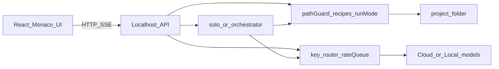

# Architecture

CelmBot is a local Node server + React UI. The browser talks only to `127.0.0.1`.

## Modules

| Area | Path | Role |
| --- | --- | --- |
| CLI | `src/cli.ts` | Bind `127.0.0.1`, open UI, port fallback |
| HTTP | `src/server/` | REST + SSE run stream |
| Safety | `src/safety/` | Folder jail, recipes, approval modes |
| Keys | `src/keys/` | Multi-key pools, RPM/RPD queue, probe |
| Agent | `src/agent/` | Tool loop, persistence, sandbox orchestrator |
| Workspace | `src/workspace/` | Editor FS + local git helpers |
| Shared types | `src/shared/types.ts` | Contracts shared with the web app |
| UI | `web/src/` | Monaco editor, keys, runs, git panel |
| Skills | `skills/` | Markdown playbooks (pstack-style) |

## Trust boundary

Anything that can write files or run a recipe goes through safety first. See [TRUST.md](TRUST.md) and [adr/0001-folder-jail.md](adr/0001-folder-jail.md).

## Tests that encode the design

- `npm run test:jail` — path escape + recipe argv checks
- `npm test` — unit + fake-LLM integration
- `npm run test:e2e` — API/SPA smoke on a portable config dir
