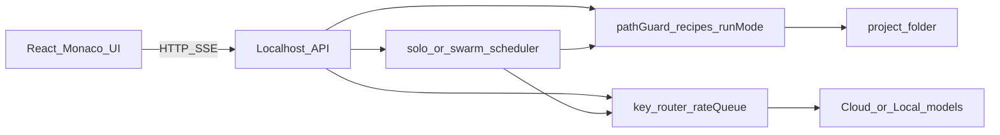

# Architecture

CelmBot is a local Node server + React UI. The browser talks only to `127.0.0.1`.

## Modules

| Area | Path | Role |
| --- | --- | --- |
| CLI | `src/cli.ts` | Bind `127.0.0.1`, mark interrupted runs, open UI |
| HTTP | `src/server/` | REST + SSE (replay last events on subscribe) |
| Safety | `src/safety/` | Folder jail, recipes, approval modes |
| Keys | `src/keys/` | Multi-key pools, RPM/RPD queue, probe, failover |
| Agent loop | `src/agent/loop.ts` | One active agent’s tool/LLM tick |
| Scheduler | `src/agent/scheduler.ts` | Worker admission, sequential fan-out, aggregate |
| Orchestrator | `src/agent/orchestrator.ts` | Frame N workers, start swarm, shared verify |
| Persistence | `src/agent/persistence.ts` | Per-run `state.json` |
| Operator session | `src/agent/session.ts`, `src/agent/sessionRunner.ts` | Chat session, message queue, drain into next run |
| Features | `src/features/flags.ts` | `swarm` on; other flags = v0.2 backlog |
| Workspace | `src/workspace/` | Editor FS + local git helpers |
| Shared types | `src/shared/types.ts` | Contracts shared with the web app |
| UI | `web/src/` | Monaco editor, operator chat, keys, swarm roster/timeline |
| Skills | `skills/` | Markdown playbooks |

## Multi-agent model

- Each agent has its own `messages`, `step`, `writeAllow`, and optional `reportStatus` (`PASS` / `ISSUES` / `BLOCKED` / `GAP`).
- `activeAgentId` selects who `tick` bills and whose write scope applies.
- Events always carry `agentId` / `role` when known.
- Orchestrated runs: workers run with isolated transcripts → shared recipe verify → optional verifier role → aggregate report event.

## Trust boundary

Anything that can write files or run a recipe goes through safety first. See [TRUST.md](TRUST.md) and [adr/0001-folder-jail.md](adr/0001-folder-jail.md).

## Free-tier swarm

Design and practices: [SWARM.md](SWARM.md).

## Tests that encode the design

- `npm run test:jail` — path escape + recipe argv checks
- `npm test` — unit + fake-LLM integration + scheduler helpers
- `npm run test:e2e` — API/SPA smoke on a portable config dir
