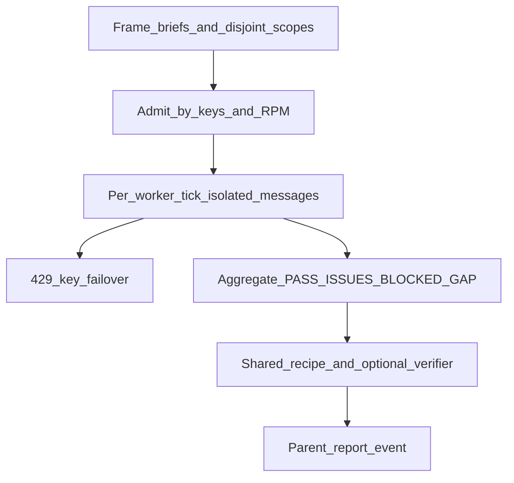

# Free-tier swarm (v0.1)

How CelmBot runs multi-agent work on free/local keys. Flags: [`src/features/flags.ts`](../src/features/flags.ts) (`swarm: true`).

## Operator journey

**Setup once** → open project, add/probe keys → set playbook (Solo or Swarm), write policy, and verify recipe → **Send** a goal in the operator chat. Approvals appear on Agent while the run is active. The aggregate **report** lands in the chat transcript when the run finishes. Send again to continue; if a run is still active, the message is **queued** and starts automatically after the current run ends (with prior report context). Activity is the raw event log. Workers do not have their own chatboxes. CelmBot does not host the pstack plugin or Cursor Plan / Agent / Ask modes.

## Out of scope

- Per-agent chatboxes
- Cursor Plan / Agent / Ask as a host UX
- Hosting or embedding the pstack plugin / slash menu
- Full poteto-mode playbook pack or 50+ skills
- Arena, interrogate, auto-review, embeddings, overnight cloud autopilot (see [ROADMAP.md](ROADMAP.md))

## Behavior (present tense)

- **Solo** — one worker, recipe-gated done.
- **Swarm (orchestrated)** — orchestrator row + N workers with briefs and write scopes; workers run with **isolated transcripts** (sequential by default).
- **Admission** — `min(maxParallelWorkers, cool tool-capable keys)`. Overlapping write globs force sequential execution.
- **429** — cooldown the key, `pickKey` failover, re-queue; only `rate_limited` if no alternate key.
- **Reports** — workers end with `PASS` / `ISSUES` / `BLOCKED`; missing status → `GAP` (not a pass).
- **Verify** — shared `run_recipe` after workers; optional `cfg.roles.verifier` agent.
- **UI** — operator chat + run chrome, roster, queue banner, aggregate report, queued follow-ups, timeline filter by agent, run history, SSE replay + reconnect poll.

## Free-tier practices

1. Concurrency follows keys × RPM, not wishful worker counts.
2. Transparent queue/cooldown in the UI; honor failover instead of silent stalls.
3. Partition writes; shared-state tools stay effectively sequential.
4. Structured handoffs; shared verify recipe.
5. Approvals carry `agentId` and can queue.

## Module map

| Piece | Path |
|---|---|
| Tick | `src/agent/loop.ts` |
| Schedule / aggregate | `src/agent/scheduler.ts` |
| Frame / start | `src/agent/orchestrator.ts` |
| Operator session | `src/agent/session.ts`, `src/agent/sessionRunner.ts` |
| Flags | `src/features/flags.ts` |
| UI | `web/src/components/{RunChrome,OperatorChat,AggregateReport,AgentRoster,QueueBanner,EventTimeline,...}` |

## v0.2 backlog

Arena, interrogate, auto-review, embeddings search, OS jail, dark theme — see [ROADMAP.md](ROADMAP.md).

## Sources

pstack (Lauren Tan / poteto, MIT) under [cursor/plugins](https://github.com/cursor/plugins/tree/main/pstack) informs verification-first parallelism. CrewAI/AutoGen/OpenHands-style practices inform free-tier admission and tool scoping. Neither dictates CelmBot’s localhost jail.
